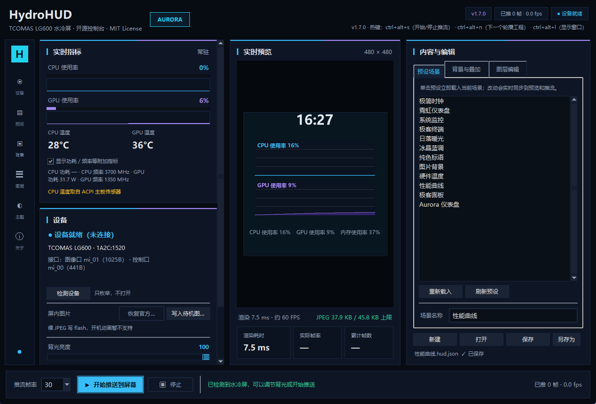
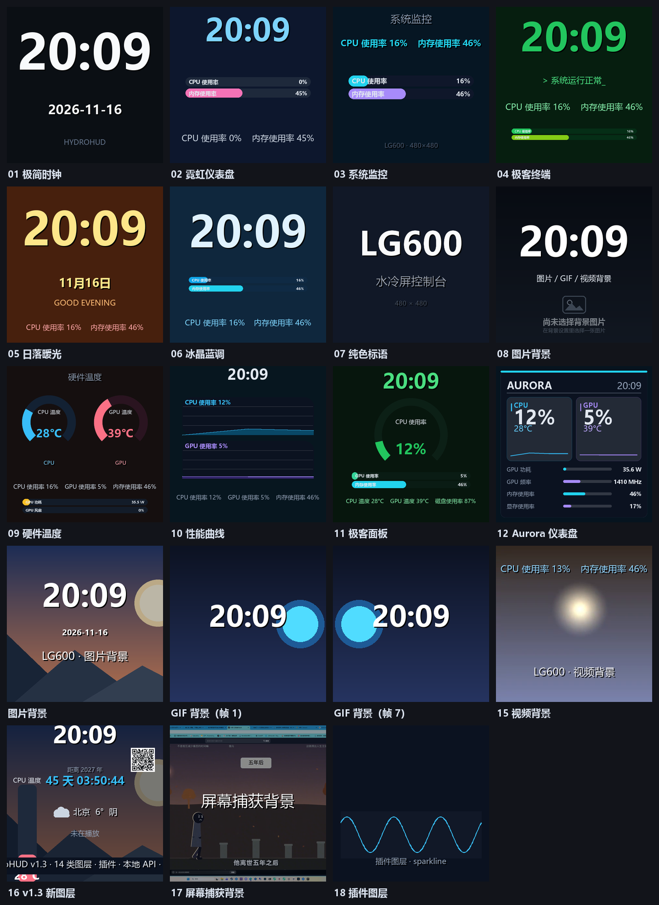

# HydroHUD

**English** | [简体中文](README.md)

**Open-source USB display control.** Turn the small screen on an all-in-one liquid cooler's pump head or a case-mounted secondary display into whatever you want it to show: images, GIFs, video, clocks, system stats, line charts, gauges — all assembled by you, streamed at 30 fps. MIT licensed, single-file exe, no drivers and no Python install required.

The first target is the **TCOMAS LG600** (USB `1A2C:1520`) pump-head display at 480×480. The vendor software only ships a handful of fixed assets, so the HID protocol was fully reverse-engineered and rewritten from scratch. Both the protocol and the porting method are in the repository, so the same approach can be applied to other panels.



<details>
<summary>Preset scene previews (click to expand)</summary>



</details>

## Supported panels

| Model | USB ID | Transport | Status |
| --- | --- | --- | --- |
| TCOMAS LG600 (pump head, 480×480) | `1A2C:1520` | HID reports + JPEG | ✅ Verified on real hardware |
| TCOMAS LG700 | `1A2C:151C` | Different USB implementation | ⬜ Unverified, contributions welcome |
| Your panel? | — | — | 👉 See "A prompt for coding agents" below |

**Documentation site**: <https://zhangyunfei0415.github.io/hydrohud/> (the same content as a static site, with search and a table of contents).

Protocol notes: [docs/PROTOCOL.md](docs/PROTOCOL.md) — packet format, control commands, how it was reverse-engineered, and the dead ends. The same panel also has two other paths: a single-file command-line tool, `lg600.py`, and a [liquidctl](https://github.com/liquidctl/liquidctl) driver adapter (which lets you manage it alongside other AIO devices).

## A prompt for coding agents (so others can port it to their own panel)

[AGENTS.md](AGENTS.md) in the repository root is a **porting manual written for coding agents**: hard constraints, the architecture diagram, a protocol cheat sheet, a seven-step porting recipe (identify the device → capture with Frida → determine the pixel format → write a transport → register the device → verify incrementally → write the docs), the full change list for adding a layer, and the hardware facts that are already settled (which paths are dead — don't retry them).

To use it, hand these lines and the repository to your agent:

> Read `AGENTS.md`. I have an XXX display (VID:PID = `xxxx:yyyy`) and I want to port HydroHUD to it.
> Follow the seven-step recipe in §4: first enumerate the device to confirm the interface and report length,
> then capture what the vendor software sends to determine the pixel format, then write a new transport and
> run the tests from §6. Tell me the conclusion after each step, and do not skip the verification order.

This path is the project's second goal: **protocol knowledge and the porting process belong to the community**, not to one person's head.

---

## Features

| Area | What you get |
| --- | --- |
| **Visual sources** | Solid color; images (JPG/PNG/WebP/BMP); GIF / animated WebP; video (MP4/AVI/MKV/WebM, needs imageio-ffmpeg); **screen capture** (mirror any region of the virtual desktop to the panel at 5 fps) |
| **System stats** (v1.2) | 23 metrics: CPU / memory usage, CPU frequency and temperature, GPU usage / temperature / VRAM / power / fan / clock, disk usage and read/write rates, network up/down, uptime, fan speed, core count. GPU goes through NVML; CPU temperature can be read from LibreHardwareMonitor / HWiNFO shared memory, and shows "—" when unavailable |
| **Stackable layers** | **15 types**: text (with `{cpu}` `{gpu_temp}` `{time}` template variables), clock, status line, progress bars, line chart, ring gauge, image sticker, **thermometer**, **countdown/anniversary**, **scrolling ticker**, **image sequence (frame animation)**, **QR code**, **weather**, **now playing**, **performance dashboard**; every layer can be hidden individually |
| **Visual editor** (v1.3) | Drag and resize layers directly on the preview canvas: 8 handles, 1/8 grid and center-line snapping, edge snapping to neighboring layers, Ctrl multi-select for moving as a group, arrow-key nudging; paired with undo / redo (`Ctrl+Z` / `Ctrl+Y`, slider drags coalesce into one step) |
| **Live preview** | What-you-see-is-what-you-get 480×480 preview, dynamic content refreshed at 10–15 fps, showing the current single-frame JPEG size (highlighted in red when over budget) |
| **Streaming** | 10 / 20 / 30 / 60 fps, static content re-sent every 2 s (the firmware watchdog requires it), stop and hot-reload (edit while it plays) |
| **Device control** | Brightness slider 0–100, screen on/off, orientation setting, read device state (rotation quadrant), one-click kill of the vendor software; **write your own standby image** (v1.6, see below) and one-click restore of the vendor asset |
| **Project files** | Scenes are saved as `.hud.json`, shareable and version-control friendly; **theme packs (`.hudpack`)** zip the project plus its referenced assets for one-click export / import |
| **Plugins** (v1.3 / v1.4) | Layer plugins live in `%APPDATA%\HydroHUD\plugins` and draw arbitrary content in a dozen lines of Python; the GUI generates the buttons automatically. Plugins can declare `params` (int / float / bool / text / color / choice) and the editor **builds the controls from that declaration** (slider / spinbox / checkbox / dropdown / color picker). A plugin that keeps raising is quarantined with a single error entry and does not affect the others; see [docs/PLUGINS.md](docs/PLUGINS.md) |
| **Community preset library** (v1.4) | "Community → Preset library" pulls scenes from a remote JSON index and falls back to the local cache when offline; it only downloads `.hud.json` files and never executes code — install and load from the presets tab |
| **Local API / CLI** (v1.3 / v1.4) | An HTTP control plane on `127.0.0.1:4780` (token-protected): read status, switch scenes, set brightness, turn the screen on/off, start / stop streaming; event streams over SSE `/events` and **WebSocket `/ws`**; ships with the `hudctl` CLI and a [Home Assistant example](examples/homeassistant/) for Stream Deck or scripted control |
| **Vendor asset import** (v1.3) | One-click scan of the official GIFs / images under `C:\Program Files (x86)\TcomasSoftware\led*/`, copied into your own asset library (vendor files are read-only, never modified) |
| **Quality of life** (v1.1) | Tray residency, global hotkeys, project playlist, drag-and-drop import, persisted UI state, launch at login, crash log, automatic reconnect after sleep/wake |

## Quick start

### Option 1: run the exe (recommended for most users)

Download `HydroHUD.exe` from [Releases](https://github.com/zhangyunfei0415/hydrohud/releases) (single file, about 72 MB) and double-click it. **Python is not required** — the ffmpeg used for video / GIF decoding is bundled.

> Close the official `TCOMAS` software first (end `DeviceDriver.exe` in Task Manager). A HID device can only be claimed by one process at a time.

### Option 2: run from source

```powershell
cd HydroHUD
C:\Python314\python.exe -m pip install -r requirements.txt
C:\Python314\python.exe -m hydrohud
```

Python 3.10+; Tkinter is required at runtime. **Windows 10/11 is the fully supported platform**: the protocol rides on hid.dll, so streaming, device control, tray, and hotkeys all work.

Linux: the hidraw transport (`hydrohud/transport.py`) and the device table are in place, `Screen` / `Control` are wired to `/dev/hidrawN`, and `pyproject.toml` plus the whole test suite pass on Linux; udev rules, a desktop entry, and install scripts live in [`packaging/linux/`](packaging/linux/), and install steps plus hidraw / hidapi report-length differences are covered in [docs/LINUX.md](docs/LINUX.md). **Streaming on real Linux hardware has not been regression-tested yet** (the repo has no Linux hardware test) — if this is your first attempt at lighting up the panel, install the udev rules per the docs first. macOS is not started.

### Command-line arguments (for launch-at-login residency)

```powershell
# Open a project and start streaming immediately — drop this into your Startup folder
HydroHUD.exe --autostream --project "D:\My Scene.hud.json"

python -m hydrohud --autostream --project "D:\My Scene.hud.json"
```

| Argument | Meaning |
| --- | --- |
| `--project PATH` | Open a `.hud.json` project at startup |
| `--autostream` | Start streaming automatically after launch (by default the app never connects to the device on its own) |
| `--smoke-shot PNG` | 1.2 s after launch, save a screenshot of the preview area as PNG, then exit automatically 0.4 s later (for unattended verification, exit code 0) |

## UI overview

```
┌───────────────┬──────────────────────┬───────────────────────┐
│  Device       │    Preview 480×480    │  Content & editing    │
│  ─────────    │                      │  ─────────            │
│  Connection   │   ┌──────────────┐   │  Preset scenes        │
│  Brightness   │   │              │   │  Background: solid /  │
│  Screen on/off│   │  live frame  │   │    image/GIF/video/   │
│  Orientation  │   │              │   │    screen capture     │
│  Read state   │   └──────────────┘   │  Layers: 15 types +   │
│               │  FPS · frame bytes    │    plugin buttons     │
│               │                      │  ─────────            │
│               │                      │  Drag canvas / resize │
├───────────────┴──────────────────────┴───────────────────────┤
│  FPS [30 ▾]   [▶ Start streaming]   [⏹ Stop]   Status: …      │
└──────────────────────────────────────────────────────────────┘
```

1. **Left column**: click "Detect device" first and confirm you see `TCOMAS LG600`. Brightness and screen on/off act on the hardware immediately.
2. **Right column**: pick a preset, or build your own — choose a background → add layers → drag them into place on the preview canvas (`Ctrl+E` toggles canvas editing).
3. **Bottom bar**: pick an FPS and click "▶ Start streaming to screen". Every later change is reflected on the panel in real time.
4. After "⏹ Stop" the panel goes dark within about 10 seconds (the firmware watchdog) — that is normal. Keep streaming for long-running content. To get the vendor picture back, just launch the TCOMAS software again.

## Editing and authoring (v1.3)

| Feature | How to use it |
| --- | --- |
| **Drag into place** | Drag layers directly on the preview canvas; while dragging they snap to the 1/8 grid, the screen center lines, and the edges and centers of other layers (6 px tolerance), with guide lines when they hit |
| **Resize** | With a layer selected, drag one of the 8 handles: rectangles change width/height, gauges change diameter, QR codes stay square, text layers only move (their size is set in the right column) |
| **Multi-select / nudge** | `Ctrl+click` adds to the selection; a multi-selection moves as a group. Arrow keys nudge 1 px, `Shift+arrow` 8 px |
| **Canvas editing toggle** | `Ctrl+E` enters / leaves canvas editing mode (outside it, the canvas is preview-only) |
| **Undo / redo** | `Ctrl+Z` / `Ctrl+Y`; continuous slider drags and layer drags coalesce into a single step, so you don't end up with hundreds of history entries |
| **15 layer types** | Right column "Layers" → "Add layer…" dropdown; field reference in [docs/LAYERS.md](docs/LAYERS.md) |
| **Theme packs** | "Theme pack → Export / Import theme pack…"; a `.hudpack` is a zip of the project plus its referenced assets, ready to send to someone else |
| **Vendor assets** | "Theme pack → Import vendor assets into the library" scans the official GIFs / images installed by the TCOMAS software |
| **Plugins** | Drop a `.py` file into `%APPDATA%\HydroHUD\plugins` and click "Plugins → Reload layer plugins"; the layer tab grows a button for it. Once a plugin declares `params`, the editor generates sliders / spinboxes / checkboxes / dropdowns / color pickers. See [docs/PLUGINS.md](docs/PLUGINS.md) |
| **Community presets** | "Community → Preset library": pick a ready-made scene from the remote index and install it in one click; offline it uses the local cache, and installed scenes show up on the presets tab |
| **Plugin folder** | "Plugins → Open plugin folder" jumps straight to `%APPDATA%\HydroHUD\plugins`, so you never have to hunt for the path |

## Platform work (v1.4)

| Feature | How to use it |
| --- | --- |
| **Automatic plugin parameter forms** | Plugins declare parameters through `PARAM_TYPES` (int / float / bool / text / color / choice); the editor builds controls from the declaration and clamps ranges automatically. Plugins only read `layer[key]` |
| **Plugin fault isolation** | A single draw taking longer than 0.25 s is logged as `slow`; after 3 consecutive exceptions the plugin is quarantined with one error entry while the other layers keep rendering (reloading plugins clears it) |
| **Permission declarations** | Plugins may declare `permissions: ["network", "filesystem"]` and the editor shows "requires network access, file read/write (informational only, not enforced)" |
| **WebSocket event stream** | `ws://127.0.0.1:4780/ws`, RFC 6455 handshake, one status JSON per second, closes after `?limit=N` messages; see [docs/AUTOMATION.md](docs/AUTOMATION.md) |
| **Home Assistant** | [examples/homeassistant/](examples/homeassistant/) holds drop-in REST sensors and service definitions |
| **Linux packaging assets** | `packaging/linux/` has udev rules, an install script, and a `.desktop` entry; installation is documented in [docs/LINUX.md](docs/LINUX.md) |
| **Linux streaming wiring** | `Screen` / `Control` select a backend per platform: `hid.dll` on Windows, `/dev/hidrawN` on Linux; frame encoding and command dispatch are the same code |

## Aurora performance panel (v1.5)

v1.5 adds a **self-contained performance dashboard** and moves the whole UI onto one visual language. It answers two questions at once: what should live on the panel, and what should you see at a glance in the app.

| Feature | Details |
| --- | --- |
| **Performance dashboard layer** | New 15th layer type `dashboard`: a title bar on top, side-by-side CPU / GPU hero cards (large usage number, temperature, history sparkline at the bottom), and an extra-metrics row below (label / mini bar / value). About 1 ms per frame on the 480 panel; the whole card scales with its share of the screen and aligns to any corner |
| **Power / clock toggles** | The hero cards (temperature + usage) are always present; power, clock, memory, VRAM and the like are "extra metrics" that you tick individually in the layer panel, or collapse in one go from the left column checkbox. Metrics this machine cannot read are greyed out and marked "unavailable" in the picker |
| **Layer visibility** | All 15 layer types get a `visible` field; turning it off makes the renderer skip the layer while the editor and project file keep it, which is the easiest way to compare variants |
| **Aurora UI** | Icon rail on the left, AURORA badge plus three status chips (version / frames / device) in the header, a cyan-violet gradient hairline on top of each card, the "Live metrics" card in the left column (CPU / GPU bars + sparklines, two temperatures, extra-metric toggles), and three cells under the preview card for render time / actual fps / total frames |
| **ACPI temperature fallback** | Machines without LibreHardwareMonitor used to show "—" for `cpu_temp` forever; now, when neither the LHM nor the HWiNFO shared memory is available, it falls back to the ACPI thermal zone (`MSAcpi_ThermalZoneTemperature`, background thread + 5 s cache, never blocking sampling) and labels it as a motherboard sensor rather than a CPU core temperature |
| **Presets** | New 12th preset, "Aurora dashboard" — install it and the panel above shows up |

To see it immediately: click "Aurora dashboard" under "Preset scenes" in the right column, or add "＋ Performance dashboard" on the Layers tab and place it yourself.

## Writing the standby image into the panel (v1.6)

The panel has its own flash slot for the "standby image" — the one the firmware shows when the machine is off or nothing is streaming. v1.6 brings that command into the UI; the `0x0A` / `0x0B` flash upload sub-protocol has been verified on real LG600 hardware.

| Feature | How to use it |
| --- | --- |
| **Write your own standby image** | "Device → Write standby image to panel flash…", or click "Write standby image…" on the device card in the left column. After you pick an image it is center-cropped to 480×480, and the highest-quality JPEG under the 1 MiB limit is chosen step by step (not the 46 KB streaming budget, so far more detail survives) |
| **Restore the vendor asset** | "Device → Restore vendor standby image": overwrite it with `led1\10002.jpg` from the vendor software, so your change is always reversible |
| **Progress and activation notice** | Writing runs on a background thread with a progress bar, so a large file never freezes the UI; when it finishes the app turns the screen off and on once and tells you that "it shows up after a screen off/on cycle" |
| **Never hogging the interface** | It opens and closes around the write: the HID interface is released immediately afterwards so streaming and the vendor software can open it right away; if streaming is running you are asked to stop first |

Protocol details and hardware experiment notes are in [docs/PROTOCOL.md](docs/PROTOCOL.md) §3.1. **The boot animation (`startup.pak`) is not supported yet**: the vendor builds it from a `frame_%d.jpg` sequence into a custom container whose structure is still undecoded, so this project only handles plain-JPEG standby images.

## Multiple panels, bilingual UI, plugin audit (v1.7)

v1.7 fixes four things that only hurt after you have used the app for a while: driving a second panel, switching language, seeing what a plugin actually asks for, and having evidence when something goes wrong.

| Feature | What it does |
| --- | --- |
| **Multiple panels** | With two or more coolers of the same model connected, the device card grows a "Target panel" dropdown; streaming, brightness, and screen on/off all apply only to the selected panel, and the device chip in the header gains a "1/2 panels" suffix. The choice is persisted and survives a restart |
| **How two identical panels are told apart** | Both panels expose the same HID paths apart from the bus address (which changes on every replug), and this hardware returns empty HID string descriptors, so there is no serial number to read. The app therefore walks two levels up with `CM_Get_Parent` to the USB composite device instance ID (for example `USB\VID_1A2C&PID_1520\A247392SS000000`) and uses that as the stable identity. On Linux it reads the USB serial number from sysfs |
| **Bilingual UI** | "Help → Interface language" switches between Simplified Chinese and English; menus, the icon rail, card titles, and the bottom bar retranslate immediately and the choice is saved. This file is the English documentation |
| **Plugin permission audit** | "Help → Audit plugin permissions…" statically parses every plugin's source for the capabilities it actually uses (network / filesystem / subprocess) and compares that against the `permissions` it declares, listing any calls it did not declare. The plugin row in the layer editor shows the same conclusion inline. **This is a readable list for the user, not a sandbox** — plugins are still ordinary Python code |
| **Structured event journal** | `%LOCALAPPDATA%\HydroHUD\logs\events.jsonl`, one JSON event per line (stream started/stopped, device enumeration, standby image writes, plugin reloads, language changes), rotated at 512 KiB with 3 parts kept. "Help → Open event log" jumps straight there. The original human-readable crash log is untouched |
| **Preset thumbnails and sorting** | The community preset library shows a thumbnail on the right, list rows carry "4.6 rating · 12k downloads", and the list sorts by rating / downloads / name. Thumbnails are cached by URL hash, capped at 1 MiB, and the offline cache is used when the index cannot be fetched |

Single-panel users see exactly the same UI as v1.6: the dropdown row stays hidden and `Screen` / `Control` keep taking the "first panel found" path.

## Hotkeys, tray, and playlist (v1.1)

| Feature | How to use it |
| --- | --- |
| **Global hotkeys** | `Ctrl+Alt+S` start/stop streaming; `Ctrl+Alt+N` switch to the next project in the playlist; `Ctrl+Alt+L` bring the window back from the tray. They work even in fullscreen games |
| **System tray** | Closing the window minimizes to the tray and keeps streaming (to quit for real use "File → Exit" or the tray menu's "Exit"); the tray context menu starts/stops streaming and switches to the next project directly |
| **Project playlist** | "Playlist" menu → "Add current project", line up several `.hud.json` files → "Start playlist"; change the interval under "Set interval…" (3–3600 s, default 30 s) |
| **Drag-and-drop import** | Drop a `.hud.json` onto the window to open it; drop a `.jpg/.png/.gif/.mp4` to make it the background immediately |
| **State memory** | Window position and size, last opened project, FPS, brightness, and playlist interval are all remembered and restored on the next launch |
| **Launch at login** | Tick "File → Launch at login": writes an `--autostream` command into `HKCU\...\Run` so the last project starts streaming at boot |
| **One-click kill of the vendor software** | "Device → End official TCOMAS software" terminates `DeviceDriver.exe` without opening Task Manager |
| **Crash log** | "Help → Open log folder"; exceptions are written to a log file automatically, which makes bug reports useful |
| **Reconnect after sleep** | When sleep/wake or USB re-enumeration drops the device, the streaming thread reconnects and carries on without you restarting anything |

## Command line / automation

There are four paths besides the GUI:

- **`hudctl` CLI** (v1.3, this repo): with the GUI running and the local API started,
  `python -m hydrohud.hudctl status` / `scene 极简时钟` / `brightness 40` / `stream off`.
  See [docs/AUTOMATION.md](docs/AUTOMATION.md).
- **Local HTTP API** (v1.3, this repo): `127.0.0.1:4780`, token in `%APPDATA%\HydroHUD\api-token.txt`,
  ready for Home Assistant / Stream Deck / your own scripts.
- The single-file command-line tool `lg600.py` (standard library + Pillow only): `python lg600.py push photo.jpg --hold 0` displays one image indefinitely.
- The [liquidctl](https://github.com/liquidctl/liquidctl) driver: `liquidctl set lcd screen static photo.png --keepalive 0`, so you can manage it alongside other AIO devices.

## System metrics (v1.2)

All 23 metrics are available as layer data sources and as template variables in text:

| Group | Metric ids | Display |
| --- | --- | --- |
| CPU | `cpu`, `cpu_freq`, `cpu_temp`, `cpu_power`, `cpu_cores` | CPU usage 32%, CPU frequency 3700 MHz, CPU temperature 46°C… |
| Memory | `ram`, `ram_used`, `ram_total` | Memory usage 75%, used memory 35.7 GB |
| GPU | `gpu`, `gpu_temp`, `gpu_mem`, `gpu_mem_used`, `gpu_mem_total`, `gpu_power`, `gpu_fan`, `gpu_clock` | GPU temperature 44°C, GPU power 94.5 W… |
| Storage / network | `disk`, `disk_read`, `disk_write`, `net_down`, `net_up` | Disk usage 86%, disk write 35.5 MB/s, network down 0.19 Mbps |
| Other | `uptime`, `fan` | Uptime 6.3 hours, fan speed 1200 RPM |

Data sources and degradation:

- **CPU / memory / disk / network**: ctypes calls straight into Win32 (`GetSystemTimes`, `GlobalMemoryStatusEx`, `GetDiskFreeSpaceExW`, `GetIfTable2`), preferring psutil when it is installed; neither path needs an extra install.
- **GPU**: calls NVIDIA `nvml.dll` directly (usage, temperature, VRAM, power, fan, clock). Without an NVIDIA card or driver these metrics show "—" and nothing else is affected.
- **CPU temperature / CPU power / fan speed**: read from the LibreHardwareMonitor / OpenHardwareMonitor / HWiNFO shared memory. **These need you to install and run one of those monitors in the background**; otherwise they show "—" (this project does not invent ACPI numbers).
- Sampling is throttled to 0.5 s on a background thread and a frame only reads cached values — 3–4 ms steady-state, so 30 fps streaming is unaffected.

### How to use the new layers

| Layer | Purpose | Key fields |
| --- | --- | --- |
| **Status line** | Show a group of metrics on one line | "Select…" to tick up to 8 |
| **Progress bars** | Metric bars (normalized per metric range automatically) | "Select…", two alternating colors |
| **Line chart** | Recent history of one metric | metric, width/height, color, fill, background, grid/title |
| **Ring gauge** | Dial plus big number for one metric | metric, diameter, thickness, color, track |
| **Text template** | Anything you like, e.g. `CPU {cpu} / GPU {gpu_temp}` | `{metric id}`, `{time}`, `{date}`, `{uptime}` |

Three new presets: **Hardware temperatures** (CPU/GPU gauges + power and fan bars), **Performance curves** (CPU/GPU dual line charts), **Geek panel** (big CPU gauge + GPU/memory bars + temperature row).

## More things to try

- **A boot-time system monitor**: pick the "System monitor" preset → save as `monitor.hud.json` → drop a shortcut to
  `HydroHUD.exe --autostream --project "D:\monitor.hud.json"` into `shell:startup` (type it in Win+R) and it lights up at boot.
- **Watch the GPU temperature curve**: pick the "Performance curves" preset; the chart accumulates the last 120 samples,
  and with the window minimized to the tray the panel still updates every frame.
- **Play your own video/GIF**: right column "Background & overlays" → type `video`/`gif` → pick the file, with `fit` set to
  `crop` to fill. The per-frame budget is 46920 bytes and the app lowers JPEG quality automatically to fit.
- **Build your own layout**: in "Layer editing", stack text, clocks, status lines, bars, charts, gauges and images freely —
  all WYSIWYG, edit while it streams.
- **Use it as a desktop widget**: drag the window to a second monitor or a corner, start streaming, and minimize
  (streaming happens on a background thread).

## Packaging the exe

```powershell
powershell -ExecutionPolicy Bypass -File build.ps1 -Clean
# Output: dist\HydroHUD.exe (single file, about 72 MB, bundles Tkinter / Pillow / imageio + ffmpeg)
```

It runs without a Python installation. The first launch is 1–2 s slower than from source (single-file unpacking).

Pushing a `v*` tag (for example `git tag v1.7.0 && git push origin v1.7.0`) triggers the CI `release` job: it runs tests and lint, packages the exe, creates the GitHub Release automatically, attaches `HydroHUD.exe`, and generates the changelog.

## Scene file format (`.hud.json`)

```json
{
  "name": "My desktop",
  "background": { "type": "solid", "color": "#0B0F14" },
  "layers": [
    { "type": "clock",  "x": 0.5, "y": 0.22, "size": 110, "color": "#E2E8F0" },
    { "type": "text",   "x": 0.5, "y": 0.46, "text": "CPU {cpu} · GPU {gpu_temp}", "size": 30, "color": "#38BDF8" },
    { "type": "gauge",  "metric": "gpu_temp", "x": 0.5, "y": 0.66, "diameter": 0.34, "thickness": 0.05, "color": "#FB7185" },
    { "type": "chart",  "metric": "cpu", "x": 0.08, "y": 0.84, "w": 0.84, "h": 0.12, "color": "#22D3EE" },
    { "type": "bars",   "items": ["ram", "disk"], "x": 0.1, "y": 0.92, "w": 0.8, "h": 0.04 }
  ]
}
```

`background.type` may be `solid` / `image` / `gif` / `video` / `capture` (image types carry `path` and `fit`: `crop` fills and crops, `fit` letterboxes, `stretch` distorts; `capture` also carries `region` and `fps`). Coordinates `x`/`y` are normalized 0–1, where `0.5` means centered.

Layer types at a glance (full field tables in [docs/LAYERS.md](docs/LAYERS.md)):

| type | Key fields | Notes |
| --- | --- | --- |
| `text` | `text`, `size`, `color`, `bold`, `align`, `shadow` | Supports `{metric id}` / `{time}` / `{date}` / `{uptime}` templates |
| `clock` | `format`, `show_date`, `date_format`, `size` | Time and date |
| `sysinfo` | `fields` (metric array), `separator`, `size` | Several metrics on one line, e.g. `CPU usage 32%    Memory usage 75%` |
| `bars` | `items`, `w`, `h`, `color`, `color2`, `bg`, `gap` | Metric bars, normalized per metric range |
| `chart` | `metric`, `w`, `h`, `color`, `color2`, `bg`, `grid`, `fill`, `label`, `points`, `smooth` | History line chart (`x`/`y` is the top-left of the area) |
| `gauge` | `metric`, `diameter`, `thickness`, `color`, `track`, `start_angle`, `sweep`, `show_unit` | Ring gauge (`x`/`y` is the center) |
| `image` | `path`, `scale`, `opacity` | Sticker |
| `thermometer` | `metric`, `w`, `h`, `color`, `track`, `show_value`, `label` | Vertical thermometer, good for CPU / GPU temperature |
| `countdown` | `target`, `title`, `format`, `done_text` | Countdown / anniversary, `target` is an ISO time string |
| `ticker` | `text`, `speed`, `direction`, `band` | Scrolling text, `direction` is `left` / `right` |
| `sequence` | `paths` (image array), `fps`, `fit`, `loop` | Frame animation: cycle a set of images at the given fps |
| `qrcode` | `data`, `size`, `fg`, `bg`, `error` | QR code, generated in pure Python, supports `{metric id}` templates |
| `weather` | `place` or `lat`/`lon`, `fields`, `icon` | Weather (Open-Meteo, no key, 10-minute cache) |
| `nowplaying` | `fields`, `show_cover`, `cover_size`, `scroll` | Now playing (Windows SMTC, needs `winsdk`; shows a placeholder when missing) |

## Technical notes

- Transport: bare Win32 HID (`hid.dll` + `setupapi.dll` through ctypes, no third-party HID library). Images go through the interface with the 1025-byte output report (MI_01); control goes through the 441-byte one (MI_00).
- A frame is a series of 1020-byte packets, with a **budget of 46 packets = 46920 bytes** (hardware testing shows the firmware renders all 46 packets; the early "15-packet limit" was copied from the vendor software's habit, not a firmware limit). JPEG quality steps down from 100 until the frame fits. **The image must always be 480×480** — a JPEG at any other size makes the device drop off the bus.
- **Watchdog**: the panel does not latch a single frame. A few seconds after the last packet it blanks / falls back to the vendor image, so even static content must be re-sent continuously.
- The vendor software's hardware rotation command only stores a setting and does not rotate the picture, so this project rotates pixels in Pillow.
- Mutually exclusive with the vendor software: the same HID interface cannot be held by two processes at once.

## Repository layout

```
HydroHUD/
├── hydrohud/
│   ├── app.py        Tkinter UI (Aurora skin, live metrics card, 15-type layer editor, canvas drag, tray / hotkeys / playlist wiring)
│   ├── render.py     scene → 480×480 image (15 layer types, 5 background types, caches, plugin dispatch)
│   ├── device.py     USB HID transport + JPEG encoding + packet framing + device table lookup (no GUI dependency)
│   ├── devices.py    device table (VID/PID, report length, packet budget, verification flag)
│   ├── transport.py  transport abstraction + FakeTransport (tests) + Linux hidraw implementation
│   ├── scenes.py     scene schema, 12 presets, project file I/O
│   ├── editor.py     canvas editor (hit testing / drag / resize / snap, geometry as pure functions)
│   ├── history.py    undo / redo stack (deep-copied snapshots, drag coalescing, dirty flag)
│   ├── sensors.py    system metric hub (23 metrics, NVML / shared memory / ctypes, history buffer)
│   ├── weather.py    weather (Open-Meteo, no key, cache + offline fallback)
│   ├── media.py      now playing (Windows SMTC, winsdk optional)
│   ├── capture.py    screen capture (ImageGrab downscaled to 480)
│   ├── plugins.py    layer plugin registry (APPDATA\HydroHUD\plugins, parameter declarations + fault isolation)
│   ├── presetslib.py community preset library (remote JSON index + offline cache + one-click install)
│   ├── api.py        local HTTP control plane (127.0.0.1:4780, token + SSE + WebSocket)
│   ├── hudctl.py     command-line client for the API
│   ├── themepack.py  .hudpack theme pack import/export
│   ├── qrmini.py     pure-Python QR encoder (no third-party dependencies)
│   ├── sysmon.py     CPU/memory sampling (legacy interface, ctypes, no third-party libraries)
│   ├── settings.py   UI state and preference persistence (atomic JSON writes)
│   ├── autostart.py  launch at login (HKCU Run registry entry)
│   ├── tray.py       system tray icon and menu (Shell_NotifyIconW, ctypes)
│   ├── hotkeys.py    global hotkeys (RegisterHotKey)
│   ├── playlist.py   rotating project playlist
│   ├── diagnostics.py crash and error logging
│   ├── i18n.py       minimal i18n (Chinese/English catalogs, thread-safe language switching)
│   └── __main__.py   python -m hydrohud entry point
├── docs/PROTOCOL.md  reverse-engineering notes for the HID protocol (including the flash upload sub-protocol)
├── docs/LAYERS.md    field reference for the 15 layer types and backgrounds
├── docs/PLUGINS.md   plugin protocol: PLUGIN dict, params declarations, isolation and permissions
├── docs/AUTOMATION.md local API / hudctl / theme packs
├── docs/LINUX.md     Linux transport layer, udev rules, and current state
├── packaging/linux/  udev rules, install script, desktop entry
├── ROADMAP.md        upcoming versions and experiments still to verify
├── AGENTS.md         porting and extension manual for coding agents
├── tests/            pytest suite (1194 tests, all pure software, no hardware needed)
├── preview/          rendering previews of presets / backgrounds / v1.3 features (contact-sheet.png is the overview)
├── examples/         sample .hud.json projects + sample plugin + Home Assistant integration
├── assets/           icons and UI screenshots
├── tools/            preview renderer / hardware self-check / headless GUI sweep (51 checks) / docs site assembler
├── launcher.py       PyInstaller entry point
├── make_icon.py      icon generator
├── build.ps1         one-command packaging
├── pyproject.toml    shared black / ruff configuration
├── mkdocs.yml        documentation site configuration (Material theme)
├── requirements-docs.txt  docs site dependencies (mkdocs-material)
└── requirements.txt
```

## Known limitations

- **Windows is the fully supported platform**: streaming, device control, the tray, and hotkeys are only verified on Windows. The Linux hidraw backend is wired up (`Screen` / `Control` dispatch per platform), and udev rules, desktop entry, and install scripts are in [docs/LINUX.md](docs/LINUX.md), but **streaming on real Linux hardware has not been regression-tested**; macOS is not started.
- Only the LG600 (PID 1520) is verified on hardware. The LG700 (`1A2C:151C`) is in the device table and assumed to use the same protocol, but has not been tested (see [docs/PROTOCOL.md](docs/PROTOCOL.md)).
- Per-frame limit of 46920 bytes: a quality-100 photo (about 42–46 KB, right at the budget) goes up unchanged; only pathological material such as per-pixel noise is forced to a lower quality.
- CPU temperature: prefer the LHM / HWiNFO shared memory (core temperature); when neither is available it falls back to the ACPI thermal zone (a motherboard sensor, useful for order of magnitude, and the UI names the source). CPU power and fan speed only come from shared memory and show "—" when it is missing.
- Chart history lives in memory only (120 samples by default, one per 0.5 s ≈ 1 minute) and restarts from zero on launch.
- Video needs ffmpeg: `pip install imageio imageio-ffmpeg`; the packaged build already bundles it.
- "Now playing" needs `pip install winsdk` (an optional dependency, not in requirements.txt); without it the layer shows placeholder text and everything else keeps working.
- "Weather" needs a network connection (Open-Meteo, no API key); offline it uses the cache and shows a placeholder if it has never fetched successfully.
- The "screen capture" background is a low-frame-rate mirror (5 fps by default, 30 max) and is not meant as a high-frame-rate video source; it grabs the whole virtual desktop, so use `region` on multi-monitor setups.
- The device cannot be opened while the vendor software is running; the UI prompts you to close it.
- Multiple-panel detection relies on the Windows composite-device instance ID (`CM_Get_Parent` two levels up). If a machine cannot enumerate a parent node, two panels of the same model fall back to grouping by `VID:PID` and are treated as one. On Linux it depends on the sysfs USB serial number, falling back to the port path.
- The bilingual UI covers menus, the icon rail, card titles, and bottom-bar buttons; field names inside the editor, parameter panels, and long passages such as the "getting started" tips are still Chinese.
- The plugin permission audit is a **static source check** — it lists what a plugin imports and which dangerous calls it makes, and is not a sandbox; `sys.modules` caching, `exec` with built strings, and `ctypes` all get around it. Read the conclusion before installing third-party plugins.
- Preset thumbnails and ratings come from the community index JSON; entries without `thumbnail` show only name and author, and the offline cache caps thumbnails at 1 MiB.
- The local API only listens on `127.0.0.1` by default; the token is equivalent to letting any local program change your screen, so keep it private.

## Roadmap

The plan ahead (v1.1 quality of life ✅ → v1.2 content ✅ → v1.3 editing ✅ → v1.4 platform work ✅ → v1.5 Aurora ✅ → v2.0 community ecosystem) is in
[ROADMAP.md](ROADMAP.md), which lists each version's features, effort estimates, and the experiments that need real hardware first
(E1/E5 have been completed on hardware: the 46-packet quality ceiling holds and 640×640 drops the device off the bus; the flash upload experiment E2 is verified on hardware — standby images can be written and are in the UI; the boot image `.pak` container format is still undecoded).

## License

MIT, see [LICENSE](LICENSE).

The protocol was reverse-engineered for interoperability purposes on hardware we own; TCOMAS, LG600, and the TCOMAS software are trademarks of their respective owners. This project is not affiliated with TCOMAS and has not been endorsed by it.
