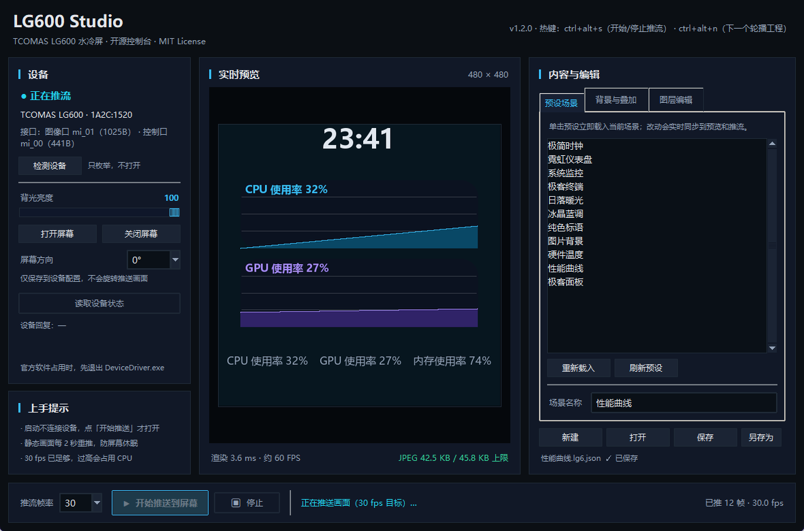
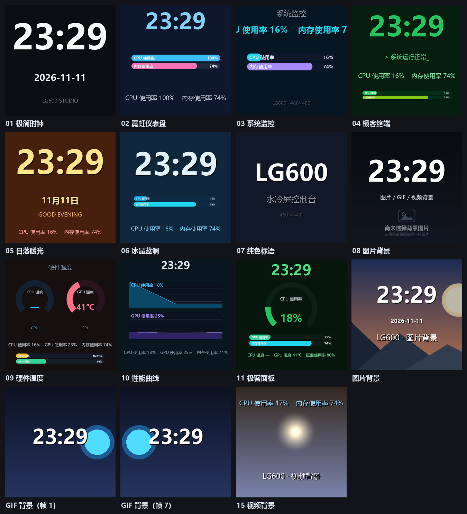

# LG600 Studio

**TCOMAS LG600（1A2C:1520）水冷头 480×480 屏幕的开源控制软件。** 图形界面、可自由导入图片 / GIF / 视频、可自己拼装画面（文字、时钟、系统监控、进度条），一键推流到屏幕。MIT 许可。

官方 TCOMAS 软件只有少量预设素材；这个项目把屏幕协议完全解密后重写了一份，想显示什么就显示什么。



<details>
<summary>预设场景预览（点击展开）</summary>



</details>

> 协议逆向记录见 [docs/PROTOCOL.md](docs/PROTOCOL.md)；同生态的另外两条路子：命令行版 [lg600.py](../lg600/lg600.py) 与 [liquidctl 驱动适配](../lg600/notes/liquidctl-adapter.md)。

---

## 功能

| 模块 | 能力 |
| --- | --- |
| **画面来源** | 纯色背景；图片（JPG/PNG/WebP/BMP）；GIF / 动态 WebP；视频（MP4/AVI/MKV/WebM，需 imageio-ffmpeg） |
| **系统状态**（v1.2） | 23 项指标：CPU / 内存占用、CPU 频率与温度、GPU 占用 / 温度 / 显存 / 功耗 / 风扇 / 频率、磁盘占用与读写速率、网络上下行、运行时间、风扇转速、核心数。GPU 走 NVML，CPU 温度可读 LibreHardwareMonitor / HWiNFO 共享内存，缺失时显示「—」 |
| **可叠加图层** | 文字（含 `{cpu}` `{gpu_temp}` `{time}` 等模板变量）、时钟（时分秒 + 日期）、状态文字（任意指标一行显示）、进度条、**折线图**（指标历史曲线）、**环形仪表盘**、图片贴图 |
| **实时预览** | 480×480 所见即所得预览，动态内容 10–15 fps 刷新，显示当前单帧 JPEG 体积（超限标红） |
| **推流** | 10 / 20 / 30 / 60 fps 可选，静态画面自动按 2 s 间隔重推（固件看门狗要求），支持停止与热更新（边改边播） |
| **设备控制** | 亮度 0–100 滑块、开/关屏幕、方向设置、读取设备状态（旋转象限）、一键结束官方软件 |
| **工程文件** | 画面保存为 `.lg6.json`，可分享、可版本管理 |
| **省心功能**（v1.1） | 系统托盘常驻、全局热键、工程轮播、拖放导入文件、界面状态记忆、开机自启、崩溃日志、休眠唤醒自动重连 |

## 快速开始

### 方式一：直接跑 exe（推荐给普通用户）

`dist\LG600Studio.exe`（单文件，约 72 MB）双击运行。**不需要安装 Python**，视频 / GIF 解码用的 ffmpeg 已内置。

> 使用前请先退出官方 `TCOMAS` 软件（任务管理器里结束 `DeviceDriver.exe`），HID 设备同一时间只能被一个程序占用。

### 方式二：源码运行

```powershell
cd lg600-studio
C:\Python314\python.exe -m pip install -r requirements.txt
C:\Python314\python.exe -m lg6studio
```

Python 3.10+；Windows 10/11（协议基于 hid.dll，暂无 Linux/macOS 版本）。

### 命令行参数（开机自启常驻）

```powershell
# 打开项目并立刻开始推流——适合放进「启动」文件夹，开机即显示画面
LG600Studio.exe --autostream --project "D:\我的场景.lg6.json"

python -m lg6studio --autostream --project "D:\我的场景.lg6.json"
```

| 参数 | 说明 |
| --- | --- |
| `--project PATH` | 启动时打开 `.lg6.json` 项目 |
| `--autostream` | 启动后自动开始推流（默认不自动连设备） |
| `--smoke-shot PNG` | 启动 1.2 s 后把预览区截图存 PNG，再 0.4 s 自动退出（用于无人值守验证，退出码 0） |

## 界面说明

```
┌───────────────┬──────────────────────┬───────────────────────┐
│  设备          │      预览 480×480     │  内容与编辑            │
│  ─────────    │                      │  ─────────            │
│  连接状态      │   ┌──────────────┐   │  预设场景列表          │
│  亮度滑块      │   │              │   │  背景：纯色/图片/GIF/视频│
│  开/关屏幕     │   │   实时画面    │   │  图层：＋文字 ＋时钟    │
│  方向下拉      │   │              │   │       ＋状态 ＋进度条  │
│  读取设备状态  │   └──────────────┘   │       ＋折线图 ＋仪表盘 │
│               │  FPS · 帧体积  字节   │       ＋图片           │
├───────────────┴──────────────────────┴───────────────────────┤
│  FPS [30 ▾]   [▶ 开始推送到屏幕]  [⏹ 停止]   状态：……          │
└──────────────────────────────────────────────────────────────┘
```

1. **左栏**先点「检测设备」，确认看到 `TCOMAS LG600`。亮度、开关屏按钮会立即作用到硬件。
2. **右栏**挑一个预设，或自己搭：选背景 → 加图层 → 拖动位置滑块微调。
3. **底部**选 FPS，点「▶ 开始推送到屏幕」。改任何设置都会实时反映到屏幕。
4. 「⏹ 停止」后屏幕大约 10 秒内会变黑（固件看门狗），这是正常现象；要长期显示就保持推流。想恢复官方画面，重新打开 TCOMAS 软件即可。

## 快捷键 · 托盘 · 轮播（v1.1）

| 功能 | 用法 |
| --- | --- |
| **全局热键** | `Ctrl+Alt+S` 开始/停止推流；`Ctrl+Alt+N` 切换到轮播里的下一个工程；`Ctrl+Alt+L` 从托盘把窗口调出来。游戏全屏时也生效 |
| **系统托盘** | 关窗口最小化到托盘继续推流（想彻底退出用「文件 → 退出」或托盘菜单的「退出程序」）；托盘右键菜单能直接开关推流、切下一个工程 |
| **工程轮播** | 「轮播」菜单 → 「加入当前工程」，把多个 `.lg6.json` 排成列表 → 「开始轮播」；间隔在「设置间隔…」里改（3–3600 秒，默认 30 s） |
| **拖放导入** | 把 `.lg6.json` 直接拖进窗口 = 打开工程；把 `.jpg/.png/.gif/.mp4` 拖进窗口 = 立刻变成背景 |
| **状态记忆** | 窗口位置大小、上次打开的工程、FPS、亮度、轮播间隔都会记住，下次启动自动恢复 |
| **开机自启** | 「文件 → 开机自启」勾选：往 `HKCU\...\Run` 写一条 `--autostream` 命令，开机自动推上次的工程 |
| **一键结束官方软件** | 「设备 → 结束官方 TCOMAS 软件」直接结束 `DeviceDriver.exe`，不用开任务管理器 |
| **崩溃日志** | 「帮助 → 打开日志目录」，异常会自动记到日志文件里，方便反馈问题 |
| **休眠唤醒重连** | 睡眠/唤醒或 USB 重新枚举导致掉线时，推流线程会自动重连并继续，无需手动重开 |

## 命令行 / 自动化

GUI 之外还有两条路子：

- `lg600.py`（纯标准库 + Pillow，单文件）：`python lg600.py push photo.jpg --hold 0` 常驻显示一张图。
- `liquidctl` 驱动：`liquidctl set lcd screen static photo.png --keepalive 0`，可和别的 AIO 设备统一管理。

## 系统状态（v1.2）

23 项指标全部可作为图层数据源，也可以写进文字模板：

| 类别 | 指标 id | 显示 |
| --- | --- | --- |
| CPU | `cpu`、`cpu_freq`、`cpu_temp`、`cpu_power`、`cpu_cores` | CPU 使用率 32%、CPU 频率 3700 MHz、CPU 温度 46°C… |
| 内存 | `ram`、`ram_used`、`ram_total` | 内存使用率 75%、已用内存 35.7 GB |
| GPU | `gpu`、`gpu_temp`、`gpu_mem`、`gpu_mem_used`、`gpu_mem_total`、`gpu_power`、`gpu_fan`、`gpu_clock` | GPU 温度 44°C、GPU 功耗 94.5 W… |
| 存储 / 网络 | `disk`、`disk_read`、`disk_write`、`net_down`、`net_up` | 磁盘使用率 86%、磁盘写入 35.5 MB/s、网络下载 0.19 Mbps |
| 其它 | `uptime`、`fan` | 运行时间 6.3 小时、风扇转速 1200 RPM |

数据来源与降级：

- **CPU / 内存 / 磁盘 / 网络**：ctypes 直调 Win32（`GetSystemTimes`、`GlobalMemoryStatusEx`、`GetDiskFreeSpaceExW`、`GetIfTable2`），有 psutil 时优先用 psutil，两者都不需要额外安装。
- **GPU**：直接调 NVIDIA `nvml.dll`（占用、温度、显存、功耗、风扇、频率）。没有 N 卡或没装驱动时这些指标显示「—」，不影响其它功能。
- **CPU 温度 / CPU 功耗 / 风扇转速**：读 LibreHardwareMonitor / OpenHardwareMonitor / HWiNFO 的共享内存。**这几项需要你自己装一个这类监控软件并在后台运行**，否则显示「—」（本项目不伪造 ACPI 读数）。
- 采样在后台线程按 0.5 s 节流，单帧只取缓存值，实测稳态 3–4 ms，不拖累 30 fps 推流。

### 新图层怎么用

| 图层 | 用途 | 关键字段 |
| --- | --- | --- |
| **状态文字** | 一行显示一组指标 | 「选择…」勾选最多 8 项 |
| **进度条** | 指标条（自动按各指标量程归一化） | 「选择…」勾选，颜色两种循环 |
| **折线图** | 某个指标最近一段时间的曲线 | 指标、宽度/高度、颜色、填充色、背景色、是否网格/标题 |
| **环形仪表盘** | 单个指标的量表 + 大数字 | 指标、直径、环宽、颜色、轨道色 |
| **文字模板** | 任意组合，如 `CPU {cpu} / GPU {gpu_temp}` | `{指标id}`、`{time}`、`{date}`、`{uptime}` |

新增三个预设：**硬件温度**（CPU/GPU 双仪表 + 功耗风扇条）、**性能曲线**（CPU/GPU 双折线图）、**极客面板**（大号 CPU 仪表 + GPU/内存条 + 温度行）。

## 更多玩法

- **开机常驻系统监控**：右栏选「系统监控」预设 → 保存为 `监控.lg6.json` → 把
  `LG600Studio.exe --autostream --project "D:\监控.lg6.json"` 的快捷方式丢进
  `shell:startup`（Win+R 输入）即可开机自动上屏。
- **看 GPU 温度曲线**：选「性能曲线」预设，折线图会攒最近 120 个采样点；把窗口缩到托盘，
  屏幕照样每帧更新。
- **放自己的视频/GIF**：右栏「背景与叠加」→ 类型选 `video`/`gif` → 选文件，`fit` 用
  `crop` 铺满。单帧上限 46920 字节，程序会自动降 JPEG 质量塞进去。
- **自己拼界面**：「图层编辑」里任意叠文字、时钟、状态行、进度条、折线图、仪表盘、贴图，
  全部所见即所得，边改边播。
- **做成桌面挂件**：把窗口拖到副屏/角落，点开始推流后最小化即可（推流在后台线程）。

## 打包 exe

```powershell
powershell -ExecutionPolicy Bypass -File build.ps1 -Clean
# 产物：dist\LG600Studio.exe（单文件，约 72 MB，含 Tkinter / Pillow / imageio + ffmpeg）
```

无 Python 环境也能运行。首次启动会比源码方式慢 1–2 秒（单文件解包）。

## 场景文件格式（`.lg6.json`）

```json
{
  "name": "我的桌面",
  "background": { "type": "solid", "color": "#0B0F14" },
  "layers": [
    { "type": "clock",  "x": 0.5, "y": 0.22, "size": 110, "color": "#E2E8F0" },
    { "type": "text",   "x": 0.5, "y": 0.46, "text": "CPU {cpu} · GPU {gpu_temp}", "size": 30, "color": "#38BDF8" },
    { "type": "gauge",  "metric": "gpu_temp", "x": 0.5, "y": 0.66, "diameter": 0.34, "thickness": 0.05, "color": "#FB7185" },
    { "type": "chart",  "metric": "cpu", "x": 0.08, "y": 0.84, "w": 0.84, "h": 0.12, "color": "#22D3EE" },
    { "type": "bars",   "items": ["ram", "disk"], "x": 0.1, "y": 0.92, "w": 0.8, "h": 0.04 }
  ]
}
```

`background.type` 可为 `solid` / `image` / `gif` / `video`（后三者带 `path` 与 `fit`：`crop` 裁剪填满、`fit` 留黑边、`stretch` 拉伸）。坐标 `x`/`y` 为 0–1 归一化，`0.5` 表示居中。

图层类型一览：

| type | 关键字段 | 说明 |
| --- | --- | --- |
| `text` | `text`、`size`、`color`、`bold`、`align`、`shadow` | 支持 `{指标id}` / `{time}` / `{date}` / `{uptime}` 模板 |
| `clock` | `format`、`show_date`、`date_format`、`size` | 时间日期 |
| `sysinfo` | `fields`（指标数组）、`separator`、`size` | 一行多指标，如 `CPU 使用率 32%    内存使用率 75%` |
| `bars` | `items`、`w`、`h`、`color`、`color2`、`bg`、`gap` | 指标进度条，自动按量程归一化 |
| `chart` | `metric`、`w`、`h`、`color`、`color2`、`bg`、`grid`、`fill`、`label`、`points`、`smooth` | 历史折线图（`x`/`y` 为区域左上角） |
| `gauge` | `metric`、`diameter`、`thickness`、`color`、`track`、`start_angle`、`sweep`、`show_unit` | 环形仪表（`x`/`y` 为圆心） |
| `image` | `path`、`scale`、`opacity` | 贴图 |

## 技术要点

- 传输：裸 Win32 HID（`hid.dll` + `setupapi.dll`，ctypes 直调，无第三方 HID 库）。图像走 1025 字节输出报文的接口（MI_01），控制走 441 字节的接口（MI_00）。
- 一帧 = 若干 1020 字节分包，**预算 46 包 = 46920 字节**（实测固件能把 46 包完整渲染；早期"15 包上限"是照抄官方软件的习惯，不是固件限制）。JPEG 质量自 100 自适应下调直到装进去。**画面必须恒为 480×480**，非 480×480 的 JPEG 会让设备掉线。
- **看门狗**：屏幕不锁存单帧，停流数秒即黑屏/回落官方画面，所以静态图也必须持续重推。
- 官方软件的硬件旋转命令只是存配置、不转画面，所以本项目的旋转在 Pillow 里转像素。
- 与官方软件互斥：同一 HID 接口不能同时被两个进程占用。

## 目录结构

```
lg600-studio/
├── lg6studio/
│   ├── device.py     USB HID 传输 + JPEG 编码 + 报文分帧（无 GUI 依赖）
│   ├── render.py     场景 → 480×480 图像（7 类图层、GIF/视频背景、缓存）
│   ├── scenes.py     场景 schema、11 个预设、工程文件读写
│   ├── sensors.py    系统指标采集中心（23 项，NVML / 共享内存 / ctypes，含历史缓冲）
│   ├── sysmon.py     CPU/内存采样（旧接口，ctypes，无第三方库）
│   ├── settings.py   界面状态与偏好持久化（JSON 原子写）
│   ├── autostart.py  开机自启（HKCU Run 注册表项）
│   ├── tray.py       系统托盘图标与菜单（Shell_NotifyIconW，ctypes）
│   ├── hotkeys.py    全局热键（RegisterHotKey）
│   ├── playlist.py   工程轮播列表
│   ├── diagnostics.py 崩溃日志
│   ├── app.py        Tkinter 界面
│   └── __main__.py   python -m lg6studio 入口
├── docs/PROTOCOL.md  屏幕 HID 协议逆向记录
├── ROADMAP.md        后续版本规划与待验证实验
├── tests/            pytest 用例（184 项：渲染、图表/仪表、场景、传感器、模块、报文分帧）
├── preview/          预设渲染预览图（contact-sheet.png 是总览）
├── examples/         示例工程 .lg6.json
├── assets/           图标、界面截图
├── tools/            预览图 / 测试素材 / 真机自检脚本
├── launcher.py       PyInstaller 入口
├── make_icon.py      生成图标
├── build.ps1         一键打包
└── requirements.txt
```

## 已知限制

- 仅 Windows；仅 LG600（PID 1520）。LG700（1A2C:151C）走另一套 USB 实现，未验证。
- 单帧 46920 字节上限：质量 100 的照片（约 42–46 KB，正好吃满预算）能原样上屏；只有逐像素噪点这种病态素材才会被迫降质量。
- CPU 温度 / CPU 功耗 / 风扇转速依赖第三方监控软件的共享内存（LHM / HWiNFO），没装就显示「—」。
- 折线图历史只存在于内存（默认 120 个采样点，0.5 s 一个 ≈ 1 分钟），重启后重新累积。
- 视频需要 ffmpeg：`pip install imageio imageio-ffmpeg`，打包版已内置。
- 官方软件开着时无法连接设备，界面会提示退出官方软件。

## 路线图

未来规划（v1.1 顺手 ✅ → v1.2 内容 → v1.3 协议深挖 → v1.4 跨平台 → v2.0 平台化）见
[ROADMAP.md](ROADMAP.md)，其中列了各版本的功能清单、工作量、需要先用真机验证的 6 个实验
（E1/E5 已在真机做完：46 包画质上限成立，640×640 会让设备掉线；剩下 flash 上传换开机图等）。

## 许可

MIT，见 [LICENSE](LICENSE)。协议为互操作性目的逆向自自有硬件；TCOMAS 与 LG600 为其各自所有者的商标，本项目与 TCOMAS 无关联。
