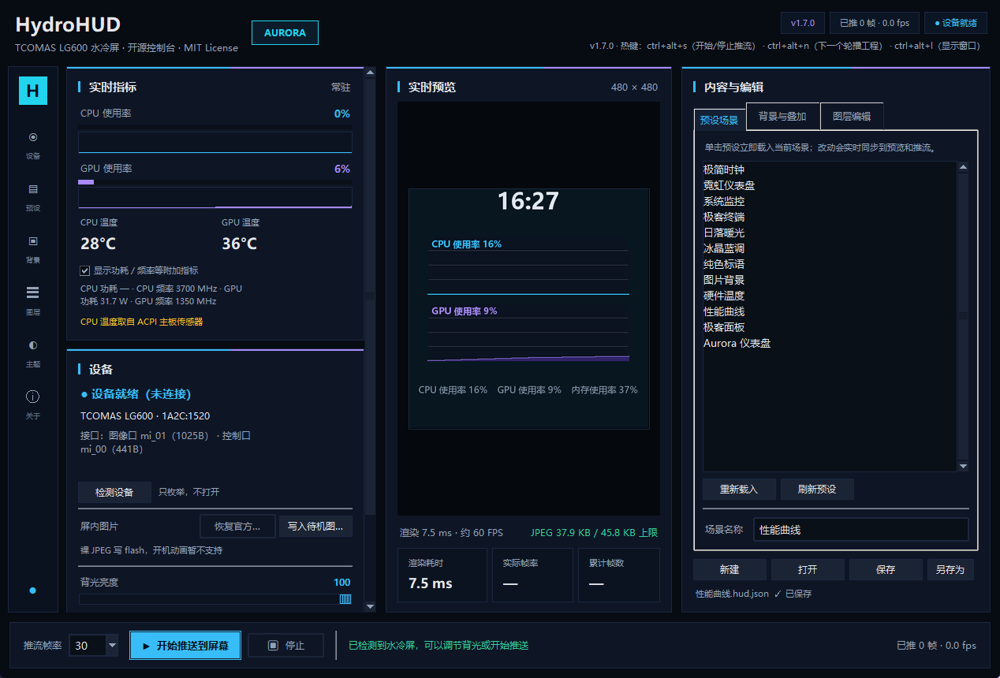
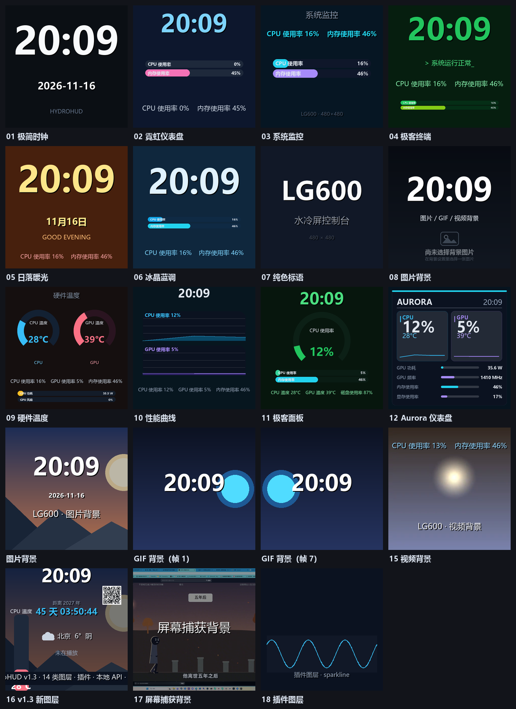

# HydroHUD

**开源 USB 屏幕控制软件。** 把一体式水冷头 / 机箱副屏上的那块小屏幕，变成一个想显示什么就显示什么的显示器：图片、GIF、视频、时钟、系统状态、折线图、仪表盘，全部自己拼，30 fps 推流。MIT 许可，单文件 exe，不装驱动、不装 Python。

首个目标机型是 **TCOMAS LG600**（1A2C:1520）水冷头的 480×480 屏 —— 官方软件只给少量固定素材，这里把 HID 协议完全逆向后重写了一份。协议与移植方法全部写进仓库，方便把同一套思路套到别的型号上。



<details>
<summary>预设场景预览（点击展开）</summary>



</details>

## 支持的屏幕

| 型号 | USB ID | 传输 | 状态 |
| --- | --- | --- | --- |
| TCOMAS LG600（水冷头 480×480） | `1A2C:1520` | HID 报文 + JPEG | ✅ 真机验证 |
| TCOMAS LG700 | `1A2C:151C` | 另一套 USB 实现 | ⬜ 未验证，欢迎贡献 |
| 你的屏幕？ | — | — | 👉 见下方「给 agent 的提示词」 |

协议笔记：[docs/PROTOCOL.md](docs/PROTOCOL.md)（报文格式、控制命令、逆向过程、踩过的坑）。同一块屏还有另外两条路子：单文件命令行版 `lg600.py` 与 [liquidctl](https://github.com/liquidctl/liquidctl) 驱动适配（后者可和别的 AIO 设备统一管理）。

## 给 agent 的提示词（让别人也能适配自己的屏幕）

仓库根目录的 [AGENTS.md](AGENTS.md) 是**写给编码 agent 的移植说明书**：硬约束、架构图、协议速查表、七步移植配方（识别设备 → Frida 抓包 → 判像素格式 → 写 transport → 注册设备 → 递增验证 → 写文档）、新增图层的完整改动清单、以及已经确定的硬件事实（哪些路走不通，别再试）。

用法是把这几句话连同仓库丢给你的 agent：

> 读 `AGENTS.md`。我有一块 XXX 屏幕（VID:PID = `xxxx:yyyy`），想把 HydroHUD 适配到它上面。
> 按 §4 的七步配方做：先枚举设备确认接口和报文长度，再抓官方软件发的报文判断像素格式，
> 然后写新的 transport 并跑 §6 的测试。每步做完告诉我结论，不要跳过验证顺序。

这条路径本身就是项目的第二个目标：**协议知识和移植流程属于社区**，而不是锁在某个人脑子里。

---

## 功能

| 模块 | 能力 |
| --- | --- |
| **画面来源** | 纯色背景；图片（JPG/PNG/WebP/BMP）；GIF / 动态 WebP；视频（MP4/AVI/MKV/WebM，需 imageio-ffmpeg）；**屏幕捕获**（把虚拟桌面的任意区域按 5 fps 镜像到屏上） |
| **系统状态**（v1.2） | 23 项指标：CPU / 内存占用、CPU 频率与温度、GPU 占用 / 温度 / 显存 / 功耗 / 风扇 / 频率、磁盘占用与读写速率、网络上下行、运行时间、风扇转速、核心数。GPU 走 NVML，CPU 温度可读 LibreHardwareMonitor / HWiNFO 共享内存，缺失时显示「—」 |
| **可叠加图层** | **14 类**：文字（含 `{cpu}` `{gpu_temp}` `{time}` 等模板变量）、时钟、状态文字、进度条、折线图、环形仪表盘、图片贴图、**温度计**、**倒计时/纪念日**、**滚动文字**、**图片序列（帧动画）**、**二维码**、**天气**、**正在播放** |
| **可视化编辑器**（v1.3） | 在预览画布上直接拖动 / 缩放图层：8 个手柄、1/8 网格与中心线吸附、相邻图层边缘吸附、Ctrl 多选整体移动、方向键微移；配合撤销 / 重做（`Ctrl+Z` / `Ctrl+Y`，拖动滑块合并为一步） |
| **实时预览** | 480×480 所见即所得预览，动态内容 10–15 fps 刷新，显示当前单帧 JPEG 体积（超限标红） |
| **推流** | 10 / 20 / 30 / 60 fps 可选，静态画面自动按 2 s 间隔重推（固件看门狗要求），支持停止与热更新（边改边播） |
| **设备控制** | 亮度 0–100 滑块、开 / 关屏幕、方向设置、读取设备状态（旋转象限）、一键结束官方软件 |
| **工程文件** | 画面保存为 `.hud.json`，可分享、可版本管理；**主题包 `.hudpack`** 把工程 + 引用的素材打成一个 zip，一键导出 / 导入 |
| **插件**（v1.3 / v1.4） | 图层插件放在 `%APPDATA%\HydroHUD\plugins`，用十几行 Python 画任意内容，GUI 自动生成按钮；插件可以声明 `params`（int / float / bool / text / color / choice），编辑器据此**自动生成控件**（滑块 / 数字框 / 勾选框 / 下拉 / 取色器）；连续抛异常的插件会被隔离，只记一条错误，不影响其它插件；详见 [docs/PLUGINS.md](docs/PLUGINS.md) |
| **社区预设库**（v1.4） | 「社区 → 预设库」从远程 JSON 索引拉取场景，离线时回落本地缓存；只下载 `.hud.json`，不执行任何代码，装好即可在预设页载入 |
| **本地 API / CLI**（v1.3 / v1.4） | `127.0.0.1:4780` 的 HTTP 控制面（token 保护）：读状态、切场景、调亮度、开关屏、开始 / 停止推流；SSE `/events` 与 **WebSocket `/ws`** 两种事件流；配套 `hudctl` 命令行和 [Home Assistant 示例](examples/homeassistant/)，方便 Stream Deck / 脚本调用 |
| **官方素材导入**（v1.3） | 一键扫描 `C:\Program Files (x86)\TcomasSoftware\led*/` 里的官方 GIF / 图片，复制进自己的素材库（只读官方文件，不修改） |
| **省心功能**（v1.1） | 系统托盘常驻、全局热键、工程轮播、拖放导入文件、界面状态记忆、开机自启、崩溃日志、休眠唤醒自动重连 |

## 快速开始

### 方式一：直接跑 exe（推荐给普通用户）

到 [Releases](https://github.com/zhangyunfei0415/hydrohud/releases) 下载 `HydroHUD.exe`（单文件，约 72 MB）双击运行。**不需要安装 Python**，视频 / GIF 解码用的 ffmpeg 已内置。

> 使用前请先退出官方 `TCOMAS` 软件（任务管理器里结束 `DeviceDriver.exe`），HID 设备同一时间只能被一个程序占用。

### 方式二：源码运行

```powershell
cd HydroHUD
C:\Python314\python.exe -m pip install -r requirements.txt
C:\Python314\python.exe -m hydrohud
```

Python 3.10+；运行时需要 Tkinter。**Windows 10/11 为完整支持**：协议基于 hid.dll，推流、设备控制、托盘、热键全部可用。

Linux：底层的 hidraw 传输层（`hydrohud/transport.py`）与设备表已经就位，udev 规则、桌面入口和安装脚本在 [`packaging/linux/`](packaging/linux/)，装法与 hidraw 与 hidapi 的报文长度差异见 [docs/LINUX.md](docs/LINUX.md)。**端到端推流仍属 v1.4 进行中**，现在还只能跑测试与离线渲染，不会点亮屏幕。macOS 尚未开始。

### 命令行参数（开机自启常驻）

```powershell
# 打开项目并立刻开始推流——适合放进「启动」文件夹，开机即显示画面
HydroHUD.exe --autostream --project "D:\我的场景.hud.json"

python -m hydrohud --autostream --project "D:\我的场景.hud.json"
```

| 参数 | 说明 |
| --- | --- |
| `--project PATH` | 启动时打开 `.hud.json` 项目 |
| `--autostream` | 启动后自动开始推流（默认不自动连设备） |
| `--smoke-shot PNG` | 启动 1.2 s 后把预览区截图存 PNG，再 0.4 s 自动退出（用于无人值守验证，退出码 0） |

## 界面说明

```
┌───────────────┬──────────────────────┬───────────────────────┐
│  设备          │      预览 480×480     │  内容与编辑            │
│  ─────────    │                      │  ─────────            │
│  连接状态      │   ┌──────────────┐   │  预设场景列表          │
│  亮度滑块      │   │              │   │  背景：纯色/图片/GIF/  │
│  开/关屏幕     │   │   实时画面    │   │        视频/屏幕捕获   │
│  方向下拉      │   │              │   │  图层：14 类 + 插件按钮 │
│  读取设备状态  │   └──────────────┘   │  ─────────            │
│               │  FPS · 帧体积  字节   │  画布拖动 / 手柄缩放    │
├───────────────┴──────────────────────┴───────────────────────┤
│  FPS [30 ▾]   [▶ 开始推送到屏幕]  [⏹ 停止]   状态：……          │
└──────────────────────────────────────────────────────────────┘
```

1. **左栏**先点「检测设备」，确认看到 `TCOMAS LG600`。亮度、开关屏按钮会立即作用到硬件。
2. **右栏**挑一个预设，或自己搭：选背景 → 加图层 → 在预览画布上直接拖动摆位（`Ctrl+E` 进 / 出画布编辑）。
3. **底部**选 FPS，点「▶ 开始推送到屏幕」。改任何设置都会实时反映到屏幕。
4. 「⏹ 停止」后屏幕大约 10 秒内会变黑（固件看门狗），这是正常现象；要长期显示就保持推流。想恢复官方画面，重新打开 TCOMAS 软件即可。

## 编辑与创作（v1.3）

| 功能 | 用法 |
| --- | --- |
| **拖动摆位** | 预览画布上直接拖图层；拖动时自动吸附到 1/8 网格、屏幕中心线、其它图层的边缘与中心（容差 6 px），命中时出现辅助线 |
| **缩放图层** | 选中后拖 8 个手柄：矩形类改宽高，仪表盘改直径，二维码保持正方形，文字类只能移动（字号在右栏调） |
| **多选 / 微调** | `Ctrl+单击` 加选，多选时按整体偏移；方向键微移 1 px，`Shift+方向键` 8 px |
| **画布编辑开关** | `Ctrl+E` 进入 / 退出画布编辑模式（退出后画布只做预览） |
| **撤销 / 重做** | `Ctrl+Z` / `Ctrl+Y`；拖滑块、拖图层的连续操作会合并成一步，不会刷出上百条历史 |
| **14 类图层** | 右栏「图层」→ 「添加图层…」下拉选，字段说明见 [docs/LAYERS.md](docs/LAYERS.md) |
| **主题包** | 「主题包 → 导出 / 导入主题包…」，`.hudpack` = 工程 + 引用素材的 zip，可直接发给别人 |
| **官方素材** | 「主题包 → 导入官方素材到素材库」，扫描已装的 TCOMAS 软件里的 GIF / 图片 |
| **插件** | 往 `%APPDATA%\HydroHUD\plugins` 丢一个 `.py`，点「插件 → 重载图层插件」，图层页签会出现对应按钮；插件声明了 `params` 后，编辑器会自动生成滑块 / 数字框 / 勾选框 / 下拉 / 取色器。写法见 [docs/PLUGINS.md](docs/PLUGINS.md) |
| **社区预设** | 「社区 → 预设库」，从远程索引挑现成场景一键装上；离线时用本地缓存，装好即出现在预设页 |
| **插件目录** | 「插件 → 打开插件目录」直接跳进 `%APPDATA%\HydroHUD\plugins`，不用自己找路径 |

## 平台化（v1.4）

| 功能 | 用法 |
| --- | --- |
| **插件参数自动表单** | 插件用 `PARAM_TYPES`（int / float / bool / text / color / choice）声明参数，编辑器按声明生成控件并自动夹取范围，插件只读 `layer[key]` |
| **插件故障隔离** | 单次绘制超过 0.25 s 记入 `slow`；连续 3 次抛异常后该插件被 quarantine，只留一条错误，其它图层继续渲染（重载插件即恢复） |
| **权限声明** | 插件可声明 `permissions: ["network", "filesystem"]`，编辑器显示「需要网络访问、文件读写（仅供参考，不做强制）」 |
| **WebSocket 事件流** | `ws://127.0.0.1:4780/ws`，RFC 6455 握手，每秒一条状态 JSON，`?limit=N` 发满即关；见 [docs/AUTOMATION.md](docs/AUTOMATION.md) |
| **Home Assistant** | [examples/homeassistant/](examples/homeassistant/) 里是可直接用的 REST 传感器 + 服务定义 |
| **Linux 打包资源** | `packaging/linux/` 有 udev 规则、安装脚本、`.desktop` 入口，装法见 [docs/LINUX.md](docs/LINUX.md) |

## 快捷键 · 托盘 · 轮播（v1.1）

| 功能 | 用法 |
| --- | --- |
| **全局热键** | `Ctrl+Alt+S` 开始/停止推流；`Ctrl+Alt+N` 切换到轮播里的下一个工程；`Ctrl+Alt+L` 从托盘把窗口调出来。游戏全屏时也生效 |
| **系统托盘** | 关窗口最小化到托盘继续推流（想彻底退出用「文件 → 退出」或托盘菜单的「退出程序」）；托盘右键菜单能直接开关推流、切下一个工程 |
| **工程轮播** | 「轮播」菜单 → 「加入当前工程」，把多个 `.hud.json` 排成列表 → 「开始轮播」；间隔在「设置间隔…」里改（3–3600 秒，默认 30 s） |
| **拖放导入** | 把 `.hud.json` 直接拖进窗口 = 打开工程；把 `.jpg/.png/.gif/.mp4` 拖进窗口 = 立刻变成背景 |
| **状态记忆** | 窗口位置大小、上次打开的工程、FPS、亮度、轮播间隔都会记住，下次启动自动恢复 |
| **开机自启** | 「文件 → 开机自启」勾选：往 `HKCU\...\Run` 写一条 `--autostream` 命令，开机自动推上次的工程 |
| **一键结束官方软件** | 「设备 → 结束官方 TCOMAS 软件」直接结束 `DeviceDriver.exe`，不用开任务管理器 |
| **崩溃日志** | 「帮助 → 打开日志目录」，异常会自动记到日志文件里，方便反馈问题 |
| **休眠唤醒重连** | 睡眠/唤醒或 USB 重新枚举导致掉线时，推流线程会自动重连并继续，无需手动重开 |

## 命令行 / 自动化

GUI 之外有四条路子：

- **`hudctl` 命令行**（v1.3，本仓库）：GUI 开着并启动本地 API 后，
  `python -m hydrohud.hudctl status` / `scene 极简时钟` / `brightness 40` / `stream off`。
  详见 [docs/AUTOMATION.md](docs/AUTOMATION.md)。
- **本地 HTTP API**（v1.3，本仓库）：`127.0.0.1:4780`，token 在 `%APPDATA%\HydroHUD\api-token.txt`，
  可接 Home Assistant / Stream Deck / 自己写的脚本。
- 单文件命令行版 `lg600.py`（纯标准库 + Pillow）：`python lg600.py push photo.jpg --hold 0` 常驻显示一张图。
- [liquidctl](https://github.com/liquidctl/liquidctl) 驱动：`liquidctl set lcd screen static photo.png --keepalive 0`，可和别的 AIO 设备统一管理。

## 系统状态（v1.2）

23 项指标全部可作为图层数据源，也可以写进文字模板：

| 类别 | 指标 id | 显示 |
| --- | --- | --- |
| CPU | `cpu`、`cpu_freq`、`cpu_temp`、`cpu_power`、`cpu_cores` | CPU 使用率 32%、CPU 频率 3700 MHz、CPU 温度 46°C… |
| 内存 | `ram`、`ram_used`、`ram_total` | 内存使用率 75%、已用内存 35.7 GB |
| GPU | `gpu`、`gpu_temp`、`gpu_mem`、`gpu_mem_used`、`gpu_mem_total`、`gpu_power`、`gpu_fan`、`gpu_clock` | GPU 温度 44°C、GPU 功耗 94.5 W… |
| 存储 / 网络 | `disk`、`disk_read`、`disk_write`、`net_down`、`net_up` | 磁盘使用率 86%、磁盘写入 35.5 MB/s、网络下载 0.19 Mbps |
| 其它 | `uptime`、`fan` | 运行时间 6.3 小时、风扇转速 1200 RPM |

数据来源与降级：

- **CPU / 内存 / 磁盘 / 网络**：ctypes 直调 Win32（`GetSystemTimes`、`GlobalMemoryStatusEx`、`GetDiskFreeSpaceExW`、`GetIfTable2`），有 psutil 时优先用 psutil，两者都不需要额外安装。
- **GPU**：直接调 NVIDIA `nvml.dll`（占用、温度、显存、功耗、风扇、频率）。没有 N 卡或没装驱动时这些指标显示「—」，不影响其它功能。
- **CPU 温度 / CPU 功耗 / 风扇转速**：读 LibreHardwareMonitor / OpenHardwareMonitor / HWiNFO 的共享内存。**这几项需要你自己装一个这类监控软件并在后台运行**，否则显示「—」（本项目不伪造 ACPI 读数）。
- 采样在后台线程按 0.5 s 节流，单帧只取缓存值，实测稳态 3–4 ms，不拖累 30 fps 推流。

### 新图层怎么用

| 图层 | 用途 | 关键字段 |
| --- | --- | --- |
| **状态文字** | 一行显示一组指标 | 「选择…」勾选最多 8 项 |
| **进度条** | 指标条（自动按各指标量程归一化） | 「选择…」勾选，颜色两种循环 |
| **折线图** | 某个指标最近一段时间的曲线 | 指标、宽度/高度、颜色、填充色、背景色、是否网格/标题 |
| **环形仪表盘** | 单个指标的量表 + 大数字 | 指标、直径、环宽、颜色、轨道色 |
| **文字模板** | 任意组合，如 `CPU {cpu} / GPU {gpu_temp}` | `{指标id}`、`{time}`、`{date}`、`{uptime}` |

新增三个预设：**硬件温度**（CPU/GPU 双仪表 + 功耗风扇条）、**性能曲线**（CPU/GPU 双折线图）、**极客面板**（大号 CPU 仪表 + GPU/内存条 + 温度行）。

## 更多玩法

- **开机常驻系统监控**：右栏选「系统监控」预设 → 保存为 `监控.hud.json` → 把
  `HydroHUD.exe --autostream --project "D:\监控.hud.json"` 的快捷方式丢进
  `shell:startup`（Win+R 输入）即可开机自动上屏。
- **看 GPU 温度曲线**：选「性能曲线」预设，折线图会攒最近 120 个采样点；把窗口缩到托盘，
  屏幕照样每帧更新。
- **放自己的视频/GIF**：右栏「背景与叠加」→ 类型选 `video`/`gif` → 选文件，`fit` 用
  `crop` 铺满。单帧上限 46920 字节，程序会自动降 JPEG 质量塞进去。
- **自己拼界面**：「图层编辑」里任意叠文字、时钟、状态行、进度条、折线图、仪表盘、贴图，
  全部所见即所得，边改边播。
- **做成桌面挂件**：把窗口拖到副屏/角落，点开始推流后最小化即可（推流在后台线程）。

## 打包 exe

```powershell
powershell -ExecutionPolicy Bypass -File build.ps1 -Clean
# 产物：dist\HydroHUD.exe（单文件，约 72 MB，含 Tkinter / Pillow / imageio + ffmpeg）
```

无 Python 环境也能运行。首次启动会比源码方式慢 1–2 秒（单文件解包）。

推一个 `v*` tag（例如 `git tag v1.4.0 && git push origin v1.4.0`）会触发 CI 的 `release` job：跑完测试与 lint 后打包 exe、自动建 GitHub Release、附上 `HydroHUD.exe` 并生成变更日志。

## 场景文件格式（`.hud.json`）

```json
{
  "name": "我的桌面",
  "background": { "type": "solid", "color": "#0B0F14" },
  "layers": [
    { "type": "clock",  "x": 0.5, "y": 0.22, "size": 110, "color": "#E2E8F0" },
    { "type": "text",   "x": 0.5, "y": 0.46, "text": "CPU {cpu} · GPU {gpu_temp}", "size": 30, "color": "#38BDF8" },
    { "type": "gauge",  "metric": "gpu_temp", "x": 0.5, "y": 0.66, "diameter": 0.34, "thickness": 0.05, "color": "#FB7185" },
    { "type": "chart",  "metric": "cpu", "x": 0.08, "y": 0.84, "w": 0.84, "h": 0.12, "color": "#22D3EE" },
    { "type": "bars",   "items": ["ram", "disk"], "x": 0.1, "y": 0.92, "w": 0.8, "h": 0.04 }
  ]
}
```

`background.type` 可为 `solid` / `image` / `gif` / `video` / `capture`（图片类带 `path` 与 `fit`：`crop` 裁剪填满、`fit` 留黑边、`stretch` 拉伸；`capture` 额外带 `region` 与 `fps`）。坐标 `x`/`y` 为 0–1 归一化，`0.5` 表示居中。

图层类型一览（完整字段表见 [docs/LAYERS.md](docs/LAYERS.md)）：

| type | 关键字段 | 说明 |
| --- | --- | --- |
| `text` | `text`、`size`、`color`、`bold`、`align`、`shadow` | 支持 `{指标id}` / `{time}` / `{date}` / `{uptime}` 模板 |
| `clock` | `format`、`show_date`、`date_format`、`size` | 时间日期 |
| `sysinfo` | `fields`（指标数组）、`separator`、`size` | 一行多指标，如 `CPU 使用率 32%    内存使用率 75%` |
| `bars` | `items`、`w`、`h`、`color`、`color2`、`bg`、`gap` | 指标进度条，自动按量程归一化 |
| `chart` | `metric`、`w`、`h`、`color`、`color2`、`bg`、`grid`、`fill`、`label`、`points`、`smooth` | 历史折线图（`x`/`y` 为区域左上角） |
| `gauge` | `metric`、`diameter`、`thickness`、`color`、`track`、`start_angle`、`sweep`、`show_unit` | 环形仪表（`x`/`y` 为圆心） |
| `image` | `path`、`scale`、`opacity` | 贴图 |
| `thermometer` | `metric`、`w`、`h`、`color`、`track`、`show_value`、`label` | 竖向温度计，适合 CPU / GPU 温度 |
| `countdown` | `target`、`title`、`format`、`done_text` | 倒计时 / 纪念日，`target` 为 ISO 时间字符串 |
| `ticker` | `text`、`speed`、`direction`、`band` | 滚动文字，`direction` 为 `left` / `right` |
| `sequence` | `paths`（图片数组）、`fps`、`fit`、`loop` | 帧动画，给一组图片按 fps 循环 |
| `qrcode` | `data`、`size`、`fg`、`bg`、`error` | 二维码，纯 Python 生成，支持 `{指标id}` 模板 |
| `weather` | `place` 或 `lat`/`lon`、`fields`、`icon` | 天气（Open-Meteo，免 key，10 分钟缓存） |
| `nowplaying` | `fields`、`show_cover`、`cover_size`、`scroll` | 正在播放（Windows SMTC，需 `winsdk`，未装则显示占位） |

## 技术要点

- 传输：裸 Win32 HID（`hid.dll` + `setupapi.dll`，ctypes 直调，无第三方 HID 库）。图像走 1025 字节输出报文的接口（MI_01），控制走 441 字节的接口（MI_00）。
- 一帧 = 若干 1020 字节分包，**预算 46 包 = 46920 字节**（实测固件能把 46 包完整渲染；早期"15 包上限"是照抄官方软件的习惯，不是固件限制）。JPEG 质量自 100 自适应下调直到装进去。**画面必须恒为 480×480**，非 480×480 的 JPEG 会让设备掉线。
- **看门狗**：屏幕不锁存单帧，停流数秒即黑屏/回落官方画面，所以静态图也必须持续重推。
- 官方软件的硬件旋转命令只是存配置、不转画面，所以本项目的旋转在 Pillow 里转像素。
- 与官方软件互斥：同一 HID 接口不能同时被两个进程占用。

## 目录结构

```
HydroHUD/
├── hydrohud/
│   ├── app.py        Tkinter 界面（14 类图层编辑器、画布拖动、托盘 / 热键 / 轮播接线）
│   ├── render.py     场景 → 480×480 图像（14 类图层、5 类背景、缓存、插件分发）
│   ├── device.py     USB HID 传输 + JPEG 编码 + 报文分帧 + 设备表查询（无 GUI 依赖）
│   ├── devices.py    设备表（VID/PID、报文长度、分包预算、是否已验证）
│   ├── transport.py  传输抽象 + FakeTransport（测试）+ Linux hidraw 实现
│   ├── scenes.py     场景 schema、11 个预设、工程文件读写
│   ├── editor.py     画布编辑器（命中测试 / 拖动 / 缩放 / 吸附，几何部分为纯函数）
│   ├── history.py    撤销 / 重做栈（深拷贝快照、拖动合并、脏标记）
│   ├── sensors.py    系统指标采集中心（23 项，NVML / 共享内存 / ctypes，含历史缓冲）
│   ├── weather.py    天气（Open-Meteo，免 key，缓存 + 离线降级）
│   ├── media.py      正在播放（Windows SMTC，winsdk 可选）
│   ├── capture.py    屏幕捕获（ImageGrab 缩略到 480）
│   ├── plugins.py    图层插件注册表（APPDATA\HydroHUD\plugins，参数声明 + 故障隔离）
│   ├── presetslib.py 社区预设库（远程 JSON 索引 + 离线缓存 + 一键安装）
│   ├── api.py        本地 HTTP 控制面（127.0.0.1:4780，token + SSE + WebSocket）
│   ├── hudctl.py     API 的命令行客户端
│   ├── themepack.py  .hudpack 主题包导入导出
│   ├── qrmini.py     纯 Python 二维码编码器（无第三方依赖）
│   ├── sysmon.py     CPU/内存采样（旧接口，ctypes，无第三方库）
│   ├── settings.py   界面状态与偏好持久化（JSON 原子写）
│   ├── autostart.py  开机自启（HKCU Run 注册表项）
│   ├── tray.py       系统托盘图标与菜单（Shell_NotifyIconW，ctypes）
│   ├── hotkeys.py    全局热键（RegisterHotKey）
│   ├── playlist.py   工程轮播列表
│   ├── diagnostics.py 崩溃日志
│   └── __main__.py   python -m hydrohud 入口
├── docs/PROTOCOL.md  屏幕 HID 协议逆向记录（含 flash 上传子协议）
├── docs/LAYERS.md    14 类图层与背景的字段参考
├── docs/PLUGINS.md   插件协议：PLUGIN 字典、params 参数声明、隔离与权限
├── docs/AUTOMATION.md 本地 API / hudctl / 主题包
├── docs/LINUX.md     Linux 传输层、udev 规则与现状
├── packaging/linux/  udev 规则、安装脚本、桌面入口
├── ROADMAP.md        后续版本规划与待验证实验
├── AGENTS.md         给编码 agent 的移植与扩展说明书
├── tests/            pytest 用例（928 项，全部纯软件，无需硬件）
├── preview/          预设 / 背景 / v1.3 新能力渲染预览图（contact-sheet.png 是总览）
├── examples/         示例工程 .hud.json + 示例插件 + Home Assistant 集成包
├── assets/           图标、界面截图
├── tools/            预览图 / 真机自检 / GUI 无人值守自检脚本
├── launcher.py       PyInstaller 入口
├── make_icon.py      生成图标
├── build.ps1         一键打包
├── pyproject.toml    black / ruff 共享配置
└── requirements.txt
```

## 已知限制

- **Windows 为完整支持平台**：推流、设备控制、托盘、热键只在 Windows 上验证过。Linux 已有 hidraw 传输层、udev 规则和安装脚本，端到端推流仍在 v1.4 开发中（见 [docs/LINUX.md](docs/LINUX.md)），macOS 未开始。
- 仅 LG600（PID 1520）经过真机验证。LG700（1A2C:151C）已登记设备表，协议推定与 LG600 相同但未实测（见 [docs/PROTOCOL.md](docs/PROTOCOL.md)）。
- 单帧 46920 字节上限：质量 100 的照片（约 42–46 KB，正好吃满预算）能原样上屏；只有逐像素噪点这种病态素材才会被迫降质量。
- CPU 温度 / CPU 功耗 / 风扇转速依赖第三方监控软件的共享内存（LHM / HWiNFO），没装就显示「—」。
- 折线图历史只存在于内存（默认 120 个采样点，0.5 s 一个 ≈ 1 分钟），重启后重新累积。
- 视频需要 ffmpeg：`pip install imageio imageio-ffmpeg`，打包版已内置。
- 「正在播放」需要 `pip install winsdk`（可选依赖，不在 requirements.txt 里）；未安装时该图层显示占位文案，其余功能不受影响。
- 「天气」需要联网（Open-Meteo，免 API key）；断网时用缓存，从未成功拉取过则显示占位。
- 「屏幕捕获」背景是低帧率镜像（默认 5 fps，上限 30），不适合当高帧率视频用；抓的是整个虚拟桌面，多显示器请用 `region` 选区域。
- 官方软件开着时无法连接设备，界面会提示退出官方软件。
- 本地 API 默认只监听 `127.0.0.1`；token 等同本机任意程序改屏幕的权限，不要外传。

## 路线图

未来规划（v1.1 顺手 ✅ → v1.2 内容 ✅ → v1.3 编辑 ✅ → v1.4 平台化 ✅ → v2.0 社区生态）见
[ROADMAP.md](ROADMAP.md)，其中列了各版本的功能清单、工作量、需要先用真机验证的实验
（E1/E5 已在真机做完：46 包画质上限成立，640×640 会让设备掉线；flash 上传换开机图的 E2 已实现代码、待真机验证）。

## 许可

MIT，见 [LICENSE](LICENSE)。

协议为互操作性目的、在自有硬件上逆向所得；TCOMAS、LG600 及 TCOMAS 软件是各自所有者的商标，本项目与 TCOMAS 无关联，也未获其背书。
